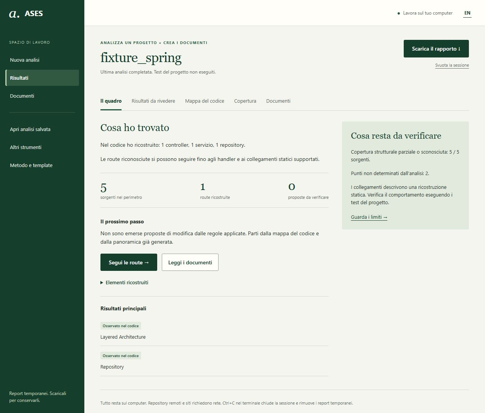
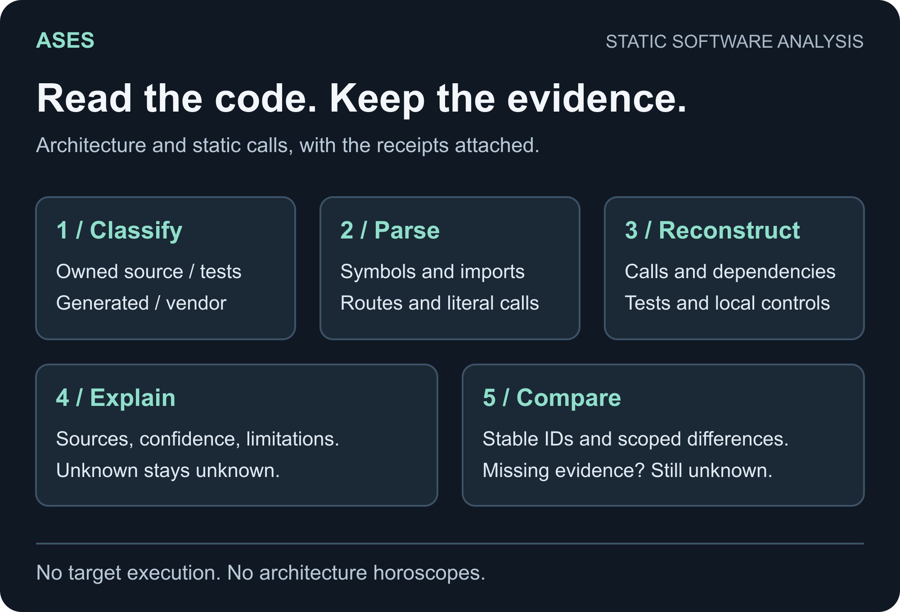
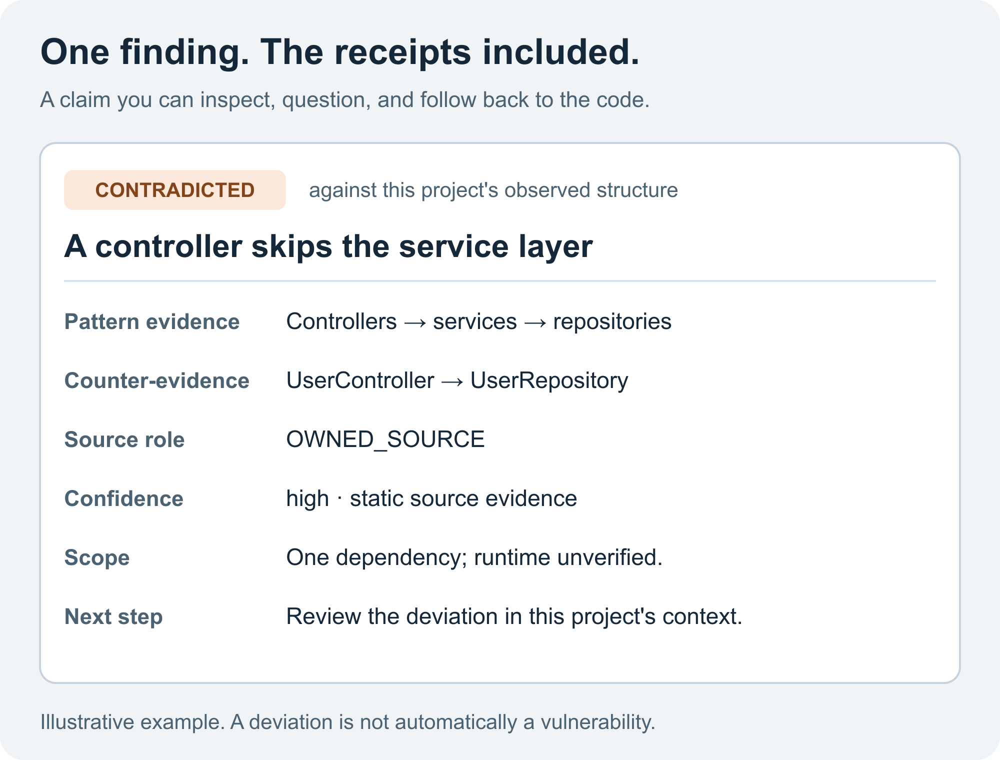

<p align="center">🔎</p>

<h1 align="center">ASES</h1>

<p align="center">Architecture &amp; Software Evidence Scanner<br/>Build with a method. Understand with evidence.</p>

<p align="center"><b>English</b> · <a href="README.it.md">Italiano</a></p>

Optional tools now include a local-model reading assistant and correlation of
supplied HTTP observations. Their hypotheses stay separate from recovered facts;
a fluent sentence is still not a passing test. [Usage and limits](docs/LOCAL-INTERPRETATION.md).

Experimental version 1.13 also reads native ReqView `.reqw`, ARFF and HTML
paragraph requirements with IDs. It keeps original sentences, distinguishes
obligations from recommendations and shows when a functional/nonfunctional type
is only a suggestion. Missing evidence does not earn a category by popular vote.
[Measured results and limits](docs/ACCURACY.md).

Version 1.13 also recognizes more explicit constraints and subjectless obligations, with review warnings. Private and conditional callable summaries retain their own-body scope; they do not become public application entries. Empty bodies receive explicit coverage, not a requirement pulled out of a hat. The optional local model has a bounded measured evaluation in [accuracy](docs/ACCURACY.md).

## Why I built it

See [how to read pattern suggestions](docs/PATTERN-REVIEW.md) for the distinction
between observed structures and refactoring candidates. A large switch is not an
automatic request to turn the project into a collection of classes.

Some projects begin with an idea and no code. Others arrive with plenty of code and a README last seen alive three refactors ago. I wanted a useful way to work from either end.

ASES combines a **software engineering toolkit** with a **Python scanner for understanding existing software**. The kit gives coding assistants a method for requirements, design, implementation, tests and maintained documentation. The scanner works back from source code to supported structure, relationships and documentation, keeping the evidence attached. It runs locally without an LLM or an API key.

They belong together: understand what exists, decide what should change, implement it, and check that code, tests and documentation still agree. Preferably without introducing a Strategy Factory Manager to fix a two-line conditional.

## Try it in your browser

With Python 3.11+ and an active virtual environment, from the repository root:

```console
python -m pip install -e "./runtime[documents]"
ases ui
```

1. In **New analysis**, choose a folder or paste a public HTTPS Git repository URL.
2. Start: see the actual stage and elapsed time, with a stop button. Options let you exclude folders without changing the project.
3. Open **Results** for the summary and review candidates. **Code map** connects symbols to their source evidence.
4. In **Documents**, start with **Operations and questions**: read what the source shows and add what you know. Write or explicitly adopt requirements and follow sources, interfaces and tests. **Complete package** saves documents, reviews and snapshots in a reopenable ZIP; its evidence can include extracted text, code fragments and paths, so inspect it before sharing. **Reduced report** keeps aggregate counts and omissions, without those details, and cannot reopen an analysis. Counts can still reveal project characteristics. See the [desk guide](docs/DESK.md) for export details.

To reopen a complete package, extract it and choose **Open saved analysis**. Opening shows one progress phase; it does not rescan the project. Changing the interface language localizes navigation and on-screen explanations, but does not translate saved Markdown. To regenerate English documents from the snapshot, use `ases documents ... --language en` as described in the [document guide](docs/DOCUMENTS.md).

No twelve-file treasure hunt to work out where to begin. The desk runs locally, in English and Italian, with no frontend dependencies to install. Git is needed for remote repositories. Analyses neither start the target code nor run its tests.

**More tools** collects comparisons, websites, artifacts, reconciliation, audit, export, capability checks, labeled-corpus measurement and recognized-output cleanup. **Method & templates** lets you edit and download the kit’s engineering documents. You supply requirements and decisions: source code cannot testify to what stakeholders originally intended.

The analyzed project stays untouched. Desk reports are temporary: download them to keep them. A failed or stopped analysis preserves the last completed result. Ctrl+C in the terminal ends the session and removes its temporary files; closing the browser tab alone does not stop the process. The [desk guide](docs/DESK.md) covers setup, results, limits and error recovery.

[](docs/images/ases-desk.jpg)

Actual screenshot using the public `runtime/tests/fixture_spring` test fixture to demonstrate the workflow. [See the route, source and evidence view](docs/images/ases-desk-evidence.jpg).

## Two parts, three starting points

| Starting point | What ASES provides | How it works |
|---|---|---|
| New project | Requirements, scenarios, design decisions, test oracles and traceability | An agent follows the engineering standard, selected skills and templates |
| Existing project with documentation | Change-impact analysis, consistency checks and updates to affected artifacts | The agent checks implementation and documentation before changing either |
| Existing project with missing or stale documentation | Source inventory, structural evidence, recovered models and documentation | The scanner builds a baseline; the agent reviews uncertainties and uses the recovered material |

**The engineering kit and the scanner have different jobs.** The kit consists of instructions, gates, skills, adapters and templates. The scanner is executable software. Installing the Python package installs the scanner; using the method also requires configuring the agent with the kit. The package does not independently interview stakeholders or implement an application from a sentence.

## Develop with the engineering kit

The workflow is:

```text
intent → requirements → analysis → system design → object design
       → implementation → tests → results and traceability
```

[STANDARD.md](STANDARD.md) defines the method; [the router](orchestrator/TASK-ROUTER.md) chooses the relevant procedures and level of rigor. A small fix can stay `LEAN`; a meaningful feature uses `STANDARD`; architectural or security-sensitive work can require `FORMAL` artifacts. Documentation changes according to impact, rather than growing a new appendix whenever someone renames a variable.

The kit includes:

- requirement validation, impact analysis and consistency review;
- system/object design, reuse decisions and API contracts;
- a Simplicity Gate before considering patterns or abstractions;
- test design with explicit expected results, regression checks and incident reporting;
- bidirectional links from requirements and decisions to code, tests and results;
- templates for SOW, RAD, SDD, ODD, design decisions and TP/TCS/TIR/TSR test documents;
- instruction adapters for several coding assistants.

The methodology draws on university software engineering material, with its sources and their roles recorded in [the source map](sources/SOURCE-MAP.md). Templates provide structure; they do not make an empty document useful by themselves.

To adopt it, place the kit in the target project's `.ases` directory and merge the appropriate adapter into the agent's existing instructions. Keep existing project instructions. The [engineering guide](docs/ENGINEERING-WORKFLOW.md) lists the files, setup and a concrete example. The legacy `scripts/ases.py` companion offers classification hints and file-presence checks; the agent remains responsible for reasoning.

## Requirements are sentences, not a stamp collection

When specifications exist, ASES recovers the available declarations: ID, text and source, plus actors, priorities and thresholds where it can separate them. It reads textual PDFs, Excel workbooks, Word and static HTML documentation. A discovered but unreadable file is reported as such; finding a PDF does not count as understanding it.

For **reverse engineering**, it starts from supported code paths: a request or public call, conditions, results, errors and calls with possible effects. It builds behavior sentences and links them to the evidence. For example, it can reconstruct that a handler checks a title, declares an error when it is missing and prepares a response with an `id` field. A method named `save` does not prove that an order was persisted.

In **Documents**, choose **Requirements** for original declarations or **Requirements reconstructed from code** for this interpretation. RAD keeps declared requirements separate from reconstructed behavior and links them to available evidence. SDD and ODD describe the recovered system and object structure, signatures, available contracts and static diagrams; test documents distinguish definitions, proposals and imported results. These are evidence-based views, not stakeholder-approved specifications. For a new revision, scan to a separate snapshot and compare it with the previous one; `ases documents-diff previous.ases current.ases --out impact.json` reports document changes. Reviews remain separate from generated records, and changed support is flagged for review rather than silently carried forward. The [document guide](docs/DOCUMENTS.md) explains formats and limits.

**Operations and questions** groups entries with the same handlers and asks for context that code cannot establish. Give an operation a readable name, declare a need and supply its author, scope and acceptance criterion. Confirming a reading does not automatically adopt a requirement; adoption does not verify satisfaction. RAD keeps these contributions separate from original specifications. The Save button does not come with a rubber stamp saying “done”.

Interpretation is static and partial, rather than universal domain understanding. Dynamic dispatch, complex Java flows, raster diagrams, stakeholder intent and runtime correctness still need review. ASES can reconstruct a map; telepathy remains outside the dependency list. The [document guide](docs/DOCUMENTS.md) explains what is read, what is inferred and how to regenerate a package.

## Understand existing code with the scanner

[](docs/images/ases-pipeline.svg)

The scanner separates owned source and tests from generated, vendored, tooling and documentation files. It extracts facts, builds a graph, reconstructs supported relationships and exports readable documents plus tool-neutral data. Source code, imports and build scripts are read as data; the target application is never executed.

You can use it to:

- inventory modules, classes, functions, interfaces, persistence and test declarations;
- recover supported routes, handlers, calls and bounded entry-to-boundary paths;
- inspect local control/session signals and static test links;
- review observed architecture, patterns, conformance and justified refactoring candidates;
- inspect frontend components, templates, services, literal requests and supported frontend/backend matches;
- generate a documented baseline and compare later snapshots without treating line movement as a new application.

| Area | Current extraction | Practical boundary |
|---|---|---|
| JavaScript / TypeScript | Inert Tree-sitter parsing for `.js/.jsx/.mjs/.cjs/.ts/.tsx/.mts/.cts`; lexical bindings, literal modules, re-exports, CommonJS forms, callbacks and selected Express/NestJS constructs | Compiler aliases, computed dispatch and higher-order behavior remain incomplete |
| Python | AST declarations, imports, heuristic call links, selected web decorators and ORM hints | Call resolution is partial; it does not implement Python's runtime binding semantics |
| Java | Heuristic type/member/dependency extraction and selected Spring-like annotations | It is not a Java compiler; servlet route mappings and overload dispatch are not comprehensively reconstructed |
| Frontend | Selected Angular/React-style structure, templates, typed Angular HTTP clients, admitted imported clients, ambient fetch and literal HTML forms | Template grammars are partial; embedded Vue/Svelte scripts and runtime rendering are not exhaustively parsed |
| Other inventoried languages | File/source-role inventory where recognized | Inventory does not imply a structural parser exists |

Imports establish candidates. Static calls establish reconstructed use. Neither establishes network traffic. An `HttpClient` wrapper is not automatically a design-pattern emergency.

## Findings with their reasoning attached

[](docs/images/ases-output.svg)

Results preserve evidence, counter-evidence, assumptions, categorical confidence and limitations. Finding states distinguish `OBSERVED`, `INFERRED`, `OPPORTUNITY`, `HINT`, `UNKNOWN`, `CONTRADICTED` and `SUPPRESSED`. Evidence states are a separate vocabulary. Public static relations and paths remain inferred, even when the supporting syntax is directly observed.

A class called `Factory` earns no design-pattern medal for showing up. A test link does not establish that the test ran or passed. A detected control does not establish effective protection. Conformance rules follow architecture first observed in that project; they do not impose a universal preferred architecture.

Entity identity, finding fingerprint, observation identity and snapshot identity serve different purposes. Harmless formatting can change locations and source hashes without changing meaning. Absence needs comparable scope and the relevant analysis method; a missing result is not automatically a resolved finding.

## Run a source scan

The direct route is `ases ui`. For detailed setup, automation and terminal use:

<details>
<summary>Environment and CLI commands</summary>

From the repository root, with Python 3.11 or newer in an active virtual environment:

```sh
python -m pip install -e ./runtime
ases --version

ases scan /path/to/project --out current.ases
ases scan https://github.com/OWNER/REPOSITORY --out remote.ases
```

For a new environment, use `python -m venv .venv`, then activate it with `.\.venv\Scripts\Activate.ps1` in PowerShell or `source .venv/bin/activate` on macOS/Linux. If PowerShell activation is unavailable, use `.\.venv\Scripts\python.exe -m pip install -e ./runtime` and `.\.venv\Scripts\ases.exe` directly. Git is required for repository URLs; local scans do not need it. Scanning does not require the development/test dependencies. See [TESTING.md](TESTING.md) to run ASES's own checks.

Choose the source scope deliberately. ASES honors its documented exclusions and `.asesignore`; it does not automatically interpret every project's Git-ignored local directory as generated code. Local experiments and temporary fixtures may need explicit exclusion.

Read the results in this order:

1. Open `current.ases/docs/SUMMARY.md` for the review summary, then `SYSTEM-OVERVIEW.md` for the structure.
2. Read `current.ases/docs/QUALITY.md` and the unknowns before judging what is missing.
3. Inspect the relevant finding in `scanner-findings.json` or `docs/ODD.md`, including evidence, assumptions and confidence; check the referenced source.
4. Use the queries below to follow a route or symbol. Run the project's own tests separately before deciding what to change.

Query the saved snapshot:

```sh
ases inspect current.ases
ases inspect current.ases --collection analysis_unknowns --limit 20
ases inspect current.ases --collection entities --select read --limit 20
ases trace current.ases "GET /users" --direction forward
ases trace current.ases read --direction backward
ases semantic-diff previous.ases current.ases
ases scan /path/to/project --out next.ases --baseline current.ases
```

Queries read saved evidence without silently rescanning mutable source. Exact ID/name/path matching reports ambiguity. Response pagination is distinct from source-analysis coverage. Canonical `entities` include declarations beyond the smaller legacy `components` projection; those counts are not interchangeable.

</details>

## What comes back

A source scan writes:

| Output | Purpose |
|---|---|
| `docs/REPORT.md`, `REPORT.it.md` (desk) | First reading in English and Italian: structure, routes, checks and next step |
| `docs/SUMMARY.md`, `SYSTEM-OVERVIEW.md` | Review guide and recovered system overview |
| `docs/RAD.md`, `SDD.md`, `ODD.md` | Behavior, architecture and object-design reconstruction from implementation evidence |
| `docs/TESTING.md`, `TRACEABILITY.yaml`, `CONTROLS.yaml`, `QUALITY.md` | Recovered test baseline, links, control observations and quality/coverage limits |
| `semantic-model.yaml`, `manifest.json`, `validation.json` | Semantic model, source/profile fingerprint and consistency checks |
| `scanner-findings.json` | Normalized findings, hints and suppressed results, feed **1.3** |
| `consumer-context.json` | Legacy consumer context **1.5** |
| `consumer-context.v2.json` | Structural snapshot **2.0**: entities, observations, normalized relations, identity mappings, hashes and scoped coverage |
| `fact-graph.json` | Internal investigation data; downstream tools can use the public contracts |

Recovered RAD/SDD/ODD describe observed or inferred implementation. They cannot recover an undocumented stakeholder decision by sheer confidence. Documents created through the engineering workflow can instead record requirements and decisions explicitly supplied and reviewed during development.

### How to interpret the result

| What you see | What it means | What to check next |
|---|---|---|
| `validation: PASS` | The generated model passes its consistency/schema checks | It does not establish complete extraction or a correct application |
| `OBSERVED` / `INFERRED` | A supported source observation / a reconstruction based on observations | Inspect evidence and assumptions; a static call is not proof of execution |
| `OPPORTUNITY` / `HINT` | A refactoring candidate / a weak lead | Confirm the design problem before changing code; neither is a verdict |
| `CONTRADICTED` | A declared rule conflicts with recovered evidence | Check that the rule, evidence and affected scope match the current project |
| `PARTIAL` / `UNKNOWN` | The relevant method is incomplete or cannot answer within this scope | Missing output is not proof of absence; coverage is separate from confidence |
| `SUPPRESSED` | A result was withheld by the rule's qualification/suppression policy | Review the recorded reason rather than treating it as a confirmed finding |
| `library_call` / `external_api_call` | An imported-library call / an admitted static API-client candidate | Neither proves network traffic; an unrecognized client's remote effects remain unresolved |
| A removed item in a diff | The item is no longer recovered in the second snapshot | Confirm comparable profiles and coverage; read `uncertain` before calling it resolved |

Confidence is categorical (`low`, `medium`, `high`), not a calibrated probability. Counts of recovered tests are declarations and links, not a test run or code-coverage report. A page that says PASS can still deserve a very close look.

### Where the files go

`--out` selects a persistent result directory. Without it, a local source scan uses `.ases`; if that directory already contains the engineering kit or other unrecognized material, the result goes to `ases-scan.ases`. The installed method is preserved. Explicit nonempty, unrecognized output directories are refused.

For a repository URL, the default persistent output is `<repository-name>.ases` in the current directory. The checkout is temporary and cleaned after scanning; the report is retained so you can inspect it. Prefer an explicit `--out` when comparing runs. Do not use the same output directory for the baseline and the new scan: an existing recognized output is replaced.

Generated outputs carry `.ases-output`. Repeated scans replace recognized generated output; cleanup requires that marker and refuses engineering kits or repository roots. A directory merely ending in `.ases` is not permission to delete it.

```sh
ases clean current.ases
ases clean --all
```

`--all` applies to recognized direct output directories in the current folder. Keep persistent results when they are useful baselines; use a temporary directory for disposable experiments. A benchmark should leave measurements, not an archaeological layer in the projects folder.

## Sites, supplied artifacts and imported observations

```sh
ases scan-site https://example.org --max-pages 5
ases scan-artifact supplied-dist --out artifact.ases
ases reconcile-artifact current.ases artifact.ases/artifact-snapshot.json
ases export current.ases --schema 2.0 --out context-v2.json
```

Site mode samples public same-origin HTML, respects `robots.txt`, and records pages, forms, script references and framework hints. It does not execute JavaScript or submit forms; source architecture and client-rendered behavior remain unobserved.

Artifact mode reads supplied local JS bundles, source maps and selected manifest fields within explicit file/byte/node bounds. Reconciliation distinguishes exact bytes, source-map assertions, ambiguity, mismatch and unknown correspondence. Optional runtime input must already come from an external collector. ASES does not run builds, acquire runtime observations, fetch missing maps, decode arbitrary transformed-symbol equivalence or infer deployment truth. A loaded script is not an executed feature.

## Independent from its consumers

ASES supplies generic engineering procedures and structural evidence. Other tools can consume that evidence for documentation, maintenance, cybersecurity and assurance alongside other sources. Risk, compliance, organizational priorities and final control-effectiveness judgments belong to the consumer. ASES works independently and does not require a consumer's internal model or a raw-graph reader.

## Validation and current state

This development version is **experimental** and requires Python 3.11 or newer. Windows, Linux (including WSL2) and macOS have been tested; exact versions, skips and remaining platform checks are listed in the [support matrix](docs/SUPPORT.md). The [accuracy guide](docs/ACCURACY.md) separates bundled synthetic regressions from new external measurements. Those measurements expose substantial gaps in free-prose recovery and functional/nonfunctional classification; preserving supplied labels is a different test. Independent review and user utility remain open.

Start with the [engineering guide](docs/ENGINEERING-WORKFLOW.md) for development, the [CLI guide](runtime/README.md) for scanner commands, and [TESTING.md](TESTING.md) to reproduce checks. [Evidence terminology](EPISTEMOLOGY.md), [pattern rules](PATTERN-RULES.md) and [consumer contracts](integrations/CONSUMER-CONTRACT.md) explain interpretation and integration. Dynamic dispatch, global middleware, servlet routes, custom clients/event buses and runtime execution remain method-specific limits. Zero speculative opportunities is a valid result.

## License

Copyright © 2026 Ferdinando Gregorio Fernandez. All rights reserved. Source is visible for portfolio evaluation; reuse, redistribution and derivative works are not permitted. See [LICENSE](LICENSE). Dependencies retain their terms in [THIRD-PARTY-NOTICES.md](THIRD-PARTY-NOTICES.md).
