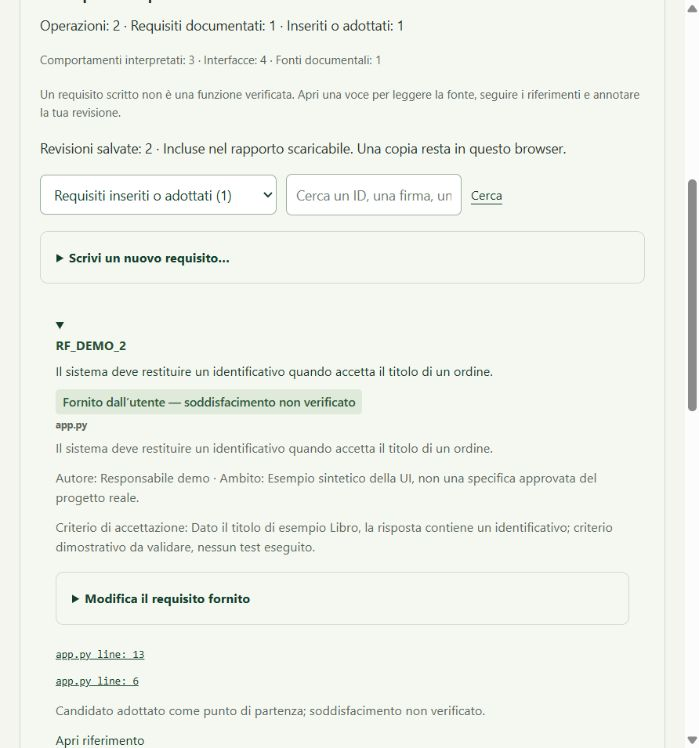

# Reading and building engineering documents

Optional local interpretation and imported HTTP observation correlation are
documented in [Local interpretation](LOCAL-INTERPRETATION.md). Generated hypotheses
remain separate from recovered declarations and static evidence.

English · [Italiano](DOCUMENTS.it.md)

Start `ases ui`, analyze a project and open **Documents**. A scan prepares a report,
RAD, SDD, ODD, test plan/specifications/incidents/results and available usage guidance.
Unsupported sections identify missing evidence; headings are not permission to invent it.



## Two ways to reach a sentence

For Python `http.server`, supported literal exact-match dispatch tables can be
recovered even when the handler class is factory-local. These are cited static
inferences. Supported ordered literal prefix lists use `/path/*` and remain subject
to shadowing and guards; dynamic registration remains partial. Recognized HTTP
entries define the behavior view; otherwise public library APIs are used. Under
the library entry budget, application paths precede auxiliary benchmark/example/work
trees and selection is spread across files. All declarations remain inventoried.

**Zero documented requirements** means no declarations isolated in recognized
formats (RF/RNF identifiers, a structured list or explicit “The system shall…” sentences), not absent needs or documentation.
Free prose is interpreted only partially. Technical entry groups do not count user
features; source test definitions, documented test cases and imported results have
separate counts. JSON/YAML without a `requirements` list stay inventoried with an
unsupported status rather than being treated as requirement prose.

For recognized HTML structures, ASES also retains original IDs from explicitly
typed requirement rows and formal headings followed by an obligation. When the
source omits the kind, the record appears under **requirements without a declared
kind**; a row without text remains incomplete. Title and status belong to the source:
“Active” does not establish satisfaction.

Parent/child references retain the original role, ID and position. An available ID
can be opened for comparison even when the linked document has not been matched
with certainty. Navigation, examples and code alone do not create requirements;
code within a requirement statement remains inert text. This support covers specific
structures: compare a known requirement with its source before treating counts as
a measure of complete documentation recovery.

Sentences without an ID retain their original wording and source position, with
an internal generated content key and no author-declared identifier. Classification
needs review; examples, labels and installation instructions are withheld.
Archive-like source paths carry an explicit warning that current release
applicability is unknown. Copies in separate files retain separate provenance;
declaration counts do not measure distinct current project needs.

**Declared in document** means the text comes from a readable specification. Its ID,
original statement, page/cell/line and source hash are retained. Actors, priorities,
thresholds and oracles may be partial. Different declarations of the same ID remain
visible; ASES does not decide which version to approve.

**Reconstructed from code — needs confirmation** means ASES interprets a supported
implementation path. It starts at HTTP handlers or public interfaces, reads conditions,
returns, errors and calls, and produces a sentence linked to its evidence. Outward
results are separated from helper returns. Calls are followed within explicit bounds;
names such as `save`, `authorize` or `validate` do not establish persistence, effective
authorization or complete validation.

This does not automatically recover original business needs. It is not universal code
understanding: dynamic dispatch, external-library behavior, concurrency and transitive
exceptions may remain unknown. Java body recovery is more limited than Python/JS-TS.
A declared comment invariant is not a proven property.

## Follow a requirement to its evidence

The initial **Operations and questions** view groups entries with the same explicit
handler set. Sharing a helper alone does not merge two features. Open a card to read
its explanation, linked calls and questions about purpose, actor and verification.
You can supply a readable name and answers; that context remains your declaration,
separate from source facts.

In **Requirements reconstructed from code**, **Claims and their evidence** links
each claim to its supporting source line. Original expressions remain available
in the details. Partially recovered paths remain partial.

1. Choose **Requirements** or **Requirements reconstructed from code**. The list shows
   the sentence, rather than only an identifier.
2. Open it and review conditions, outcomes, authority and sources. Explicit recovered
   references lead to API or test records where available.
3. Open the source or saved page/cell excerpt. Unread sources limit conclusions about
   missing references.
4. Annotate, confirm or flag a correction. Notes do not rewrite the source.
5. Download the complete package. `engineering-review.json` retains annotations separately from
   `engineering-model.json`. A new scan preserves notes on changed records as conflicts.

The browser copy depends on its origin/port and local storage. Keep and reopen the ZIP
for a durable copy; clearing browser data can remove unexported annotations. Session
reports are temporary.

## Write or adopt a requirement

In **Operations and questions** or **Authored or adopted requirements**, open **Write
a new requirement**. Supply a unique ID, functional/nonfunctional kind, statement,
author, applicable scope and independent acceptance criterion. A project without
implementation can also have user-authored requirements; ASES does not invent code.

To start from a reconstruction, select **Explicitly adopt as a requirement** and
write the need being adopted. Confirming a reading, answering a question and adopting
a requirement are separate actions. Adoption supplies human authority; satisfaction
remains **unverified**. RAD keeps these needs separate from original specifications.
Their fields can be edited from the requirement card.

New actions use `ases-engineering-review/1.1`; version 1.0 annotations remain readable.
Keep both model and review in the export: the base model is immutable, while the
review retains your declarations. If a supporting candidate changes or disappears,
the requirement survives with support **needing review**. Old context is not silently
applied to a new reconstruction. Document comparison also reads saved authored needs
and operation context.

## Supported reading

| Source | Recovery | Boundary |
|---|---|---|
| Markdown/text/YAML/JSON | Text and explicit requirement records | Free prose/custom formats remain partial |
| PDF | Text pages/tables, repeated or continued headers | No OCR or automatic diagram understanding; encryption/errors are reported |
| XLSX | All populated sheets/cells, distinct formulas/caches and simple internal references | No formula/macro execution; external/computed references may remain unresolved |
| DOCX | Paragraphs and table text | Drawing/layout semantics are not interpreted |
| HTML/Javadoc | Static text and available signatures | No scripts/generators run; documented APIs can be stale |
| JUnit/JaCoCo XML and XLSX report rows | Declared results, available dates/scope and counters | Imported results, not current execution; revision/environment may be absent |
| Selenium `.side` | Test definitions | Not test execution |
| MPP/legacy/unsupported formats | Inventory and explicit limitation | No implicit interpretation |

For PDF reading install `python -m pip install -e "./runtime[documents]"` from the
checkout. Other readers use the standard library. Missing PDF support does not stop
the scan; its absence is reported.

Input bounds: 32 MiB/document, 128 MiB total, 1,000 pages/PDF, 250,000 populated cells
per workbook and 128 MiB ZIP expansion. Code interpretation follows at most four
calls/40 entities, with 1,000 entries and 50,000 body facts per scan. Reached limits
remain visible in coverage.

## Regenerate from a saved snapshot

```console
ases documents current.ases --out documents --language en
ases documents current.ases --out reviewed-documents --review review.json --language en
ases documents-diff previous.ases current.ases --out impact.json
```

Regeneration needs no target source and never starts the project. Choose a separate
directory: unrecognized folders and manually edited generated files are protected.
Packages record parent snapshot, model version and review digest. Change inspection
follows records and references; a missing item is not automatically resolved, and a
different hash does not prove a semantic change.

## Interpret the checks

`DOCUMENT-QUALITY.md` separates complete/partial reading, unsupported sources and
deterministic/heuristic controls. Same-ID variants need context: they can be different
versions or excerpts. A nonnumeric NFR can still have a valid qualitative oracle.
An all-yes checklist, formula-generated X or test link does not prove satisfaction.

Characterization test proposals come from implementation and need an independent
requirement oracle; otherwise a test may faithfully preserve a bug. [TESTING.md](../TESTING.md)
explains inspectable requirement, field, link and check measurements. There is no
global project correctness score.

The quality report also flags documented parameters absent from signatures, explicit contract
contexts needing review, unresolved readable references and missing structured acceptance
oracles. Contract meaning, architecture decisions, test partitions and imported commands have
separate human-review controls. Technical keys and some generated body text remain English
in both views. Exported models retain extracted text, cells, comments and code fragments;
inspect them before sharing.

## Checking the reconstructed flow

The supported local-flow reader stops at an exit, retains the condition after an
early return, follows conditional return expressions and short-circuit call guards,
and recognizes supported HTTP response-parameter calls without a JS return. An
unconditional finally exit overrides earlier exits. Rebound/shadowed response
parameters are not trusted. Linked-helper error propagation remains unverified.

Open **Limits of this flow** for unresolved loops, exception dispatch, conditional
finally overrides or reached budgets (500 facts and 64 live paths per body). A method
update can change the interpretation and require an annotation to be reviewed again.

Flow profile `/3` also associates local Java branches with their outcomes, without
borrowing a following method body. Java loops, switch, exception dispatch and finalizers
remain partial; their inner exits are withheld rather than presented unconditionally.
Read the [capability table](FLOW-COVERAGE.md) for admitted scope and remaining limits.

From the checkout, run:

```sh
ases documents-evaluate runtime/tests/fixture_documents/behavior-corpus.json --out behavior-evaluation
```

The report separates TP/FP/FN for outcomes, errors and possible effects in selected
entry bodies. It retains every expected/actual claim and its sentence. This is a
closed local-flow measurement, not a whole-project semantic accuracy percentage;
no target source or test is executed. Zero positive denominators remain unmeasured.

## Start short, then follow the details

Open **The project at a glance** (`OVERVIEW.md`) for operations, available functional
and nonfunctional requirements, tests and open questions. Links lead to full-document
records. **Links in both directions** (`TRACEABILITY.md`) also shows the reverse path;
ambiguous references remain ambiguous. A count is not a successful verification.

Document comparison separates movement, signature, behavior, requirement text, scope
and method. A possible relocation does not automatically transfer confirmation.
Adopted requirements survive changed evidence with support needing review. A missing
record is not automatically resolved.

Choose **Complete package** to preserve documents, model, reviews and a content index.
The **Reduced report** contains counts and omissions only; it does not preserve the
work and cannot reopen an analysis. Inspect complete packages before sharing: they
contain extracted text and evidence.

### Read field lists as evidence, not a complete schema

For a supported local JavaScript/TypeScript constant, a return sentence may cite
two source locations: the return and the object declaration that supplies its
fields. Open both evidence links. “Partial list” means other fields may exist;
it is not a complete response contract. Mutation or uncertain binding can prevent
that inference entirely. This still describes implementation, not the original
functional requirement or proof that a nonfunctional requirement is satisfied.

In spreadsheets, use separate columns for ID, Statement/Descrizione, Actor and
Priority/Priorità. Traceability matrices also recognize headers such as
“Requirement ID” and “Descrizione Requisito”; other sheets need an explicit
requirement identifier header. A header is local to its sheet.

A literal X under a test ID retains the declared association with the row's
requirement. A direct internal reference to a cell containing a literal value is
also supported. Computed formulas, reference chains and cached formula results
are not interpreted. If the test ID has no matching definition, the association
remains unresolved: a parent test reference is not automatically expanded to its
subcases. An X does not establish test execution or success.

## Explanations before code

New scans use bounded Italian prose for simple conditions, literal result fields,
explicit errors and named possible calls. English wording keeps its existing technical
expressions. In the desk, **What it means** displays the clauses; **See the code evidence**
opens the original expressions and source navigation. Document code blocks are collapsed
under **See technical detail**. Exported Markdown retains those blocks for inspection.

Unknown expressions are explicitly marked as untranslated; names do not establish
business intent, execution or durable storage. Reconstructed behavior remains distinct
from declared requirements and verified satisfaction. Older snapshots keep their saved
wording; rescan to obtain the new method. Changed interpretation digests can require a
review without deleting adopted needs.
